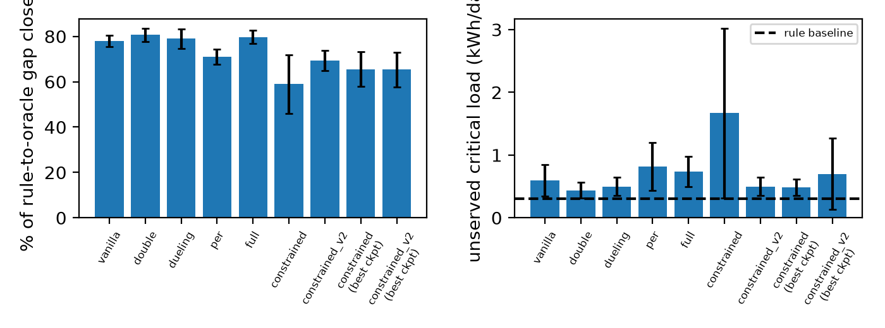
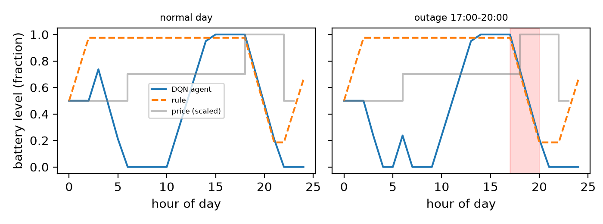

# Outage-Aware Campus Microgrid Control with Deep Reinforcement Learning

**Team:** [Name 1, Name 2, ...] | **Course:** AI, Assignment 2 (Real-Life Use Cases of RL)

An RL agent decides every hour how to operate a campus solar + battery system:
charge, discharge or idle the battery, and optionally shed non-critical load. It must cut
operating cost (energy purchases plus comfort and wear penalties) while protecting critical
load during grid outages. We implement the
simulator and the DQN family (DQN, Double, Dueling, Prioritized Replay, Lagrangian blackout
constraint) from scratch in PyTorch/NumPy. No external RL library or repository is used.

## 1. Problem and RL formulation
- **Episode:** one day, 24 hourly steps.
- **State (11-dim):** battery level, hour (sin, cos), solar now, 3-hour noisy solar forecast,
  electricity price, load, outage-active flag, noisy outage warning.
- **Actions (6, discrete):** {charge, discharge, idle} x {keep, shed non-critical load}.
- **Reward:** -(grid cost + shedding cost + forced-cut cost + battery wear + lambda * critical-load penalty) / 1000.
  With the constraint enabled, lambda is learned by dual ascent so unserved critical
  energy stays near a budget (kWh/day).
- **Data:** real hourly solar irradiance and temperature from NASA POWER (2018-2023).
  Train 2018-2021, validation 2022, held-out test 2023.
- **Simulated (assumptions, see `src/env.py`):** battery 400 kWh / 100 kW, PV conversion,
  critical and non-critical load, time-of-day tariff, outages (30% of days, 2-4 h),
  forecast and warning noise. Outage data is simulated, not measured.

## 2. Installation
Python 3.10+ is recommended (tested on 3.13, Windows).

    pip install -r requirements.txt

Dependencies: numpy, pandas, torch, matplotlib, requests (CPU is enough).

## 3. Data
`data/solar_hourly.csv` is included. To re-download from NASA POWER, set LAT/LON
in `src/fetch_data.py` and run:

    python src/fetch_data.py

## 4. Quick start (run the trained agent)

    python src/demo.py                       # trained Dueling Double DQN + PER vs rule baseline
    python src/test_baselines.py             # idle / rule / oracle on the test year

## 5. Reproduce training and results
All commands run from the repository root.

    # single model
    python src/train.py --name full --double --dueling --per --seed 0

    # ablation: vanilla, double, dueling, per, full  x  3 seeds
    python src/run_ablation.py 0 1 2

    # blackout-constrained agent (PowerShell loop; 3 seeds)
    foreach ($s in 0,1,2) { python src/train.py --name constrained --double --dueling --per --constrained --seed $s }
    foreach ($s in 0,1,2) { python src/train.py --name constrained_v2 --double --dueling --per --constrained --lam_max 5 --budget 0.5 --eta 0.05 --seed $s }

    # final tables and figures (test year 2023)
    python src/ablation_table.py
    python src/ablation_table.py --best
    python src/make_plots.py

Trained models, training logs and figures are stored in `results/`.
Approximate runtime: ~16 minutes per training run on CPU (measured: 1.3 min for 250 episodes, scaled ×12 for 3 000 episodes).

## 6. Baselines
- **idle:** never uses the battery.
- **rule:** hand-written policy (sell at peak, store spare sun, keep a 30% reserve, shed during blackouts).
- **oracle:** perfect-foresight dynamic programming for each test day. It is an upper-bound
  benchmark, not our agent, and uses information the agent never sees.

## 7. Results (test year 2023, 200 scenarios, 3 seeds, mean +- std)
"Gap closed" = (agent - rule) / (oracle - rule).

| Method | Return | Cost (Rs/day) | Unserved critical (kWh/day) | Gap closed |
|---|---|---|---|---|
| rule | -14.80 | 14744 | 0.30 | 0% |
| oracle | -11.77 | 11772 | 0.00 | 100% |
| DQN | -12.44 +- 0.07 | 12319 | 0.60 | 78.0% +- 2.4 |
| + Double | -12.36 +- 0.09 | 12272 | 0.44 | 80.6% +- 2.9 |
| + Dueling | -12.41 +- 0.13 | 12308 | 0.50 | 79.0% +- 4.3 |
| + PER | -12.65 +- 0.10 | 12486 | 0.82 | 71.1% +- 3.3 |
| Dueling Double DQN + PER (full) | -12.39 +- 0.09 | 12240 | 0.74 | 79.7% +- 2.9 |
| constrained (final ckpt) | -13.02 +- 0.39 | 12683 | 1.67 | 59.0% +- 12.9 |
| constrained (best-val ckpt) | -12.82 +- 0.23 | 12721 | 0.48 | 65.5% +- 7.6 |
| constrained_v2 (final ckpt) | -12.70 +- 0.13 | 12600 | 0.50 | 69.4% +- 4.4 |

**Protocol:** test year 2023, 200 fixed scenarios (seed 11), 3 training seeds (0–2); unconstrained
variants use final checkpoints; constrained models are shown with both final and best-validation
checkpoints (selected on 2022). Return and *G* use λ = 1 for all policies.

**Findings.** All unconstrained agents beat the rule baseline (about 16–17% lower operating cost,
71–81% of the gap to the oracle closed) but leave slightly more critical load unserved than the rule.
Differences between DQN, Double, Dueling and the full agent are within seed noise; PER alone was
slightly worse. In our first constrained run the multiplier λ saturated at its cap of 20 in all
seeds and training was unstable. For constrained_v2 (lam_max 5, budget 0.5, η 0.05), λ also
reached its cap of 5 in all seeds; the tighter cap kept training more stable but unserved critical
energy (0.50 kWh/day) remained above the 0.5 kWh/day budget, and the cost gap closed (69.4%) is
below the unconstrained full agent (79.7%), suggesting the constraint trades cost performance for
only marginal blackout protection at this budget level.

## 8. Repository layout
    src/env.py             simulator (MicrogridEnv)
    src/dqn.py             our DQN: Q-network, replay buffers, Double / Dueling / PER
    src/train.py           training script (flags for each variant and the constraint)
    src/baselines.py       idle, rule and oracle policies, evaluation harness
    src/ablation_table.py  test-year tables      src/make_plots.py   figures
    src/demo.py            run a trained agent   src/fetch_data.py   NASA POWER download
    results/               trained models (.pt), logs (.json), figures (.png)

## 9. Limitations
Outages, load, tariff and battery/PV parameters are assumptions; one site; solar data is
satellite-derived on a coarse grid; 3 seeds only, so small differences are not significant.